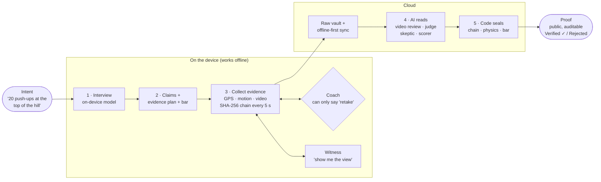

# Verified: an on-device intent and evidence factory

> A photo is no longer proof. **Verified** works the other way round: you **say what you're about to do**, and the
> app turns that intent into **claims** that can each be checked and an **evidence plan** for each one. Then it
> **collects the evidence on your phone** while you do it: GPS, motion, video and proof shots, hash-chained as
> they are captured, coached by an on-device model that can only ever say "retake". Afterwards **cloud AI reads it**
> and **deterministic code seals it**.
>
> **Intent in, proof out**, for any intent: *"20 push-ups at the top of the hill"*, *"clap 50 times"*, *"sing the
> alphabet"*, *"catch and release a bass"*.
>
> Built for Firebase **#BuildHybridAI 2026** on **iOS, Android and Web**. Every client AI call goes through
> **Firebase AI Logic hybrid inference**: Gemini Nano in Chrome and on Android, Apple Foundation Models on iOS,
> with Gemini in the cloud as the fallback and for the heavy reads.

| | |
|---|---|
| **Live app** (opens as a guest, no sign-in) | **https://verified-99e74.web.app** |
| **Demo video** (≤ 3 min) | *YouTube link added before 30 Nov 2026* |
| **iOS** | *TestFlight public link added before 30 Nov 2026* |
| **Android** | *APK on the [Releases](https://github.com/mattrickslauer/verified/releases) page before 30 Nov 2026* |
| **Contract** (data model, hashing, prompts, seal rules) | [`docs/ARCHITECTURE.md`](docs/ARCHITECTURE.md) |
| **License** | [Apache 2.0](LICENSE) |

---

## For reviewers: requirements at a glance

| Requirement | Where it is met |
|---|---|
| Uses **Firebase AI Logic hybrid inference** at runtime (imported *and* called) | Web: [`web/src/firebase.ts#L158`](web/src/firebase.ts#L158) `getGenerativeModel(ai, { mode: InferenceMode.PREFER_ON_DEVICE })`, called in [`web/src/ai.ts#L31`](web/src/ai.ts#L31). Android: [`Ai.kt#L89`](android/app/src/main/java/com/mattricks/verified/ai/Ai.kt#L89) `OnDeviceConfig(mode = InferenceMode.PREFER_ON_DEVICE)`, called at [`#L108`](android/app/src/main/java/com/mattricks/verified/ai/Ai.kt#L108). iOS: [`HybridAI.swift#L38`](ios/Verified/AI/HybridAI.swift#L38) and [`LiveCoach.swift#L42`](ios/Verified/AI/LiveCoach.swift#L42) `.hybridModel(primary: SystemLanguageModel.default, secondary: Gemini)` |
| Routing is **observable**, not assumed | `response.inferenceSource` is read on every hybrid call ([`web/src/ai.ts#L33`](web/src/ai.ts#L33), [`Ai.kt#L110`](android/app/src/main/java/com/mattricks/verified/ai/Ai.kt#L110)), stored in the Moment, and shown as an **On-device** / **Cloud** chip in the app |
| **App Check** (required by AI Logic) | reCAPTCHA Enterprise (web), Play Integrity (Android), App Attest + DeviceCheck fallback (iOS); debug providers in debug builds |
| Platforms | **Web (Chrome), Android, iOS**: three native apps, one shared contract, one backend |
| Public repo + open-source license | This repo, [Apache 2.0](LICENSE) |
| Hosted, testable without an account | https://verified-99e74.web.app: guest mode, no sign-in to browse or record |
| New work during the submission period | First commit 18 Nov 2026 (period: 11–30 Nov). Reuse is disclosed [below](#built-during-the-hackathon-and-what-was-reused) |
| No secrets in the repo | Firebase configs are git-ignored; the server AI uses a service account (no API key on any device) |

## Judging criteria: where to look

| Criterion | The short answer | Evidence |
|---|---|---|
| **Technological implementation** | 9 client AI jobs and 3 server AI jobs. Each one is placed on-device or in the cloud *for a stated reason*, on three platforms, with the routing recorded per call | [Hybrid routing table](#why-hybrid-and-where-each-model-runs) · [call sites](#where-firebase-ai-logic-is-called) · SHA-256 chain checked against [shared vectors](shared/test-vectors.json) on all platforms · `npm test` (unit, rules, emulator e2e) |
| **Design** | A complete product rather than a demo: guest mode, voice interview, evidence plan with a live checklist, realtime witness, offline-first sync, public feed, owner delete, paid verification ladder | [The factory, station by station](#the-factory-station-by-station) · open the [live app](https://verified-99e74.web.app) |
| **Potential impact** | Anything that runs on "pics or it didn't happen" (fitness challenges, fishing derbies, sponsor contests, community bets) now runs on trust. Verified produces evidence for *any* intent that anyone can audit | [The problem](#the-problem) · [business model](#business-model) |
| **Quality of the idea** | It plans the proof *before* the moment instead of judging a photo after it. And the on-device model is **deliberately weak**: it can say "retake", never "verified". Hybrid here is a trust boundary as well as a cost trade-off. AI proposes and code decides | [The idea](#the-idea-plan-the-proof-before-the-moment) · [trust model](#trust-model-honestly) |

---

## The problem

Anyone can now generate a photo, stage one, or photograph a screen. That breaks everything that pays or competes on
photo proof:

- **Fitness and outdoor challenges** ("50 push-ups", "summit before sunrise") are honour-system.
- **Tournaments and derbies** pay prize money for a photo of a catch or a finish.
- **Brands and sponsors** pay out on contests they cannot audit.
- **Friends and communities** settle bets and streaks on screenshots.

Organisers fall back on trust or slow manual review, and honest people get doubted along with the cheats.
Detecting fakes after the fact is an arms race that the detectors lose.

## The idea: plan the proof before the moment

Verified doesn't judge a photo after the fact. It **starts from the intent** and works out, up front, what evidence
would convince a fair skeptic. Then it collects exactly that, live, on the device.

**Faking one frame is easy. Faking a planned session is hard.** That means minutes of GPS, motion, timing and video
that all agree with each other and with the plan, bound by a hash chain that breaks if anything is touched.

The same pipeline takes any intent. Nothing in it is specific to one sport or use case:

| Intent | Claims the factory extracts | Evidence plan it writes |
|---|---|---|
| "20 push-ups at the top of the hill" | `place` · `action` · `count: 20` | GPS track ending on the hill · one continuous video of all 20 |
| "Clap 50 times" | `action` · `count: 50` | one continuous video of all 50 claps, ≥ 20 s |
| "Sing the alphabet" | `action` | one continuous video with audio, the whole song |
| "Catch and release a bass" | `object` · `action` · `outcome` | the fish on video in hand, the release, GPS at the water |

## The factory, station by station



**On the device**

1. **Intent in.** All three apps open straight onto the public feed as a guest; **Record a Moment** starts the
   factory. Sign-in (Google) is requested only when something must be written to the server.
2. **Interview → claims → evidence plan.** A short **voice interview** (or one typed sentence) runs on the device
   and turns the intent into **claims** that can each be checked (action, count, measure, place, time, object,
   outcome) plus an **evidence plan**: the minimum evidence per claim that would convince a fair skeptic. The final
   structuring runs in the cloud when online; offline, the on-device draft is kept. The app also previews the
   **bar** this intent will have to clear.
3. **Collect the evidence.** The plan decides how the record screen opens (Video or Photo). GPS (~1 Hz),
   accelerometer and gyroscope (10 Hz), video clips and proof shots are captured. Every 5 s the data closes into a
   chunk **SHA-256-chained** to the previous one. A live checklist ticks each requirement as its evidence is
   *captured* (never "verified": only the server decides that).
4. **On-device coach.** Each proof shot is checked against the plan **on the device** in under a second, with no
   signal, without the image leaving the phone. It can only say **"keep going"** or **"retake: body not in
   frame"**. When there is no local model, the same call falls back to Gemini in the cloud.
5. **Realtime witness.** An AI witness asks out loud and on screen for whatever the plan still lacks ("show me the
   view behind you"). **Show** opens the camera, and the shot is tagged and chained. With the phone locked, it sends
   a notification. Drafts run on the device; a cloud refine sharpens them when online.
6. **Offline-first.** Firestore offline persistence plus a local **raw vault**. With no signal the Moment keeps
   recording and syncs later. Raw data is deleted from the device only after the server provably holds all of it.

**In the cloud**

7. **AI reads the evidence.** A Cloud Function re-hashes every uploaded clip against the chain and sends the
   **whole video** to Gemini (`videoReview`) for a verdict per claim, free. Three separate Gemini calls read the
   proof shots: the **judge** (is the evidence consistent with each claim?), the **skeptic** (staging, screen
   photos, AI images, place/time mismatch) and the **scorer** (P(true) from a cheater-heavy 0.2 prior).
8. **AI sets the bar, code seals.** `barAndClaims` asks Gemini how hard the intent is (a 10 lb bass in Norway in
   December is not one from a stocked pond), and code maps that to a required score between 0.50 and 0.95. The seal
   function then recomputes the hash chain, timing, physics (no GPS jump > 70 m/s) and frame hashes, and scores
   each claim. The planned evidence plus no cheating signal earns the bar. Any cheating signal caps every claim at
   0.1. **Only this function can write the seal and the feed entry.**

**Proof out**

9. **Public, auditable proof.** Anyone can open a sealed Moment: map track, video, frame timeline, motion chart,
   AI reasons, every seal check, the bar, the score, one row per claim, and every ladder result.
10. **Verification ladder.** When the stakes are high, the owner can buy extra scrutiny: a second opinion, place &
    time from the sun angle, witness review, count & measure, or full-video review. Each check backs specific
    claim kinds and previews its effect ("if it passes → 0.58 · if it fails → 0.28"). Pass: `p' = p + s(1 − p)`.
    Fail: `p' = p(1 − s)`. Credits are spent either way. **Paying buys scrutiny, never a score.**

## Why hybrid, and where each model runs

The split follows what each job needs. Nothing on the device can verify. It can only coach, ask and preview.

| Call | Mode | Why there | Web | Android | iOS |
|---|---|---|---|---|---|
| **Live coach**, every proof shot | `PREFER_ON_DEVICE` | Many calls per session, often offline; instant, private, free. Its power is limited to "retake", so a small model is enough | Gemini Nano (image + text, JSON-constrained) | Gemini Nano (image + text) | Apple Foundation Models, fed Apple Vision labels (the on-device model is text-only) |
| **Interview turns** | `PREFER_ON_DEVICE` | Short, conversational, often offline at the trailhead | Gemini Nano | Gemini Nano | Apple FM |
| **Bar preview** | `PREFER_ON_DEVICE` | A hint only; the binding bar is set on the server | Gemini Nano | Gemini Nano | Apple FM |
| **Witness draft** | `PREFER_ON_DEVICE` | Runs about once a minute while recording, with no signal | Gemini Nano | Gemini Nano | Apple FM |
| **Witness refine** | `ONLY_IN_CLOUD` | Optional, 4 s budget, sees the latest frames | Gemini | Gemini | Gemini |
| **Structure the intention** | `ONLY_IN_CLOUD` | Must fill a strict schema (claims, evidence plan); offline it keeps the on-device draft | Gemini | Gemini | Gemini |
| **Judge** | `ONLY_IN_CLOUD` | Once per Moment, multimodal over many frames | Gemini | Gemini | Gemini |
| **Skeptic** | `ONLY_IN_CLOUD` | An independent, adversarial second read | Gemini | Gemini | Gemini |
| **Scorer** | `ONLY_IN_CLOUD` | A calibrated probability, not a yes/no | Gemini | Gemini | Gemini |
| **Bar + claims + plan** | Cloud Function | No client may set its own bar | Gemini on Vertex AI | ← | ← |
| **Video review** | Cloud Function | Whole clip from Cloud Storage (`gs://` `fileData`) | Gemini on Vertex AI | ← | ← |
| **Ladder checks** | Cloud Function | Paid with credits, so no client may set a result | Gemini on Vertex AI | ← | ← |

Every hybrid result records **which side answered** (`response.inferenceSource` on web and Android, the response's
model version on iOS). It is stored in each chunk (coach), in the intention (`interview.mode`, `preview.mode`) and
in each witness chain event (`by`), and shown as an **On-device** / **Cloud** chip.

### Where Firebase AI Logic is called

| Platform | Model setup | Calls |
|---|---|---|
| Web | [`web/src/firebase.ts`](web/src/firebase.ts) (`getAI` + `getGenerativeModel` with `InferenceMode.PREFER_ON_DEVICE` / `ONLY_IN_CLOUD`) | [`web/src/ai.ts`](web/src/ai.ts), [`web/src/components/Interview.tsx`](web/src/components/Interview.tsx), [`web/src/witnessAgent.ts`](web/src/witnessAgent.ts) |
| Android | [`android/.../ai/Ai.kt`](android/app/src/main/java/com/mattricks/verified/ai/Ai.kt) (`Firebase.ai(...).generativeModel(onDeviceConfig = OnDeviceConfig(mode = InferenceMode.PREFER_ON_DEVICE))`) | same file, used by `record/` (coach, [`Interview.kt`](android/app/src/main/java/com/mattricks/verified/record/Interview.kt), witness in `RecordViewModel.kt`) and `judge/` |
| iOS | [`ios/Verified/AI/HybridAI.swift`](ios/Verified/AI/HybridAI.swift), [`LiveCoach.swift`](ios/Verified/AI/LiveCoach.swift) (`generativeModelSession(model: .hybridModel(primary: SystemLanguageModel.default, secondary: geminiModel))`) | [`JudgeRunner.swift`](ios/Verified/AI/JudgeRunner.swift), [`InterviewModel.swift`](ios/Verified/Record/InterviewModel.swift), [`WitnessAgent.swift`](ios/Verified/Record/WitnessAgent.swift) |
| Cloud Functions | [`functions/src/ai.ts`](functions/src/ai.ts) (`@google/genai`, Vertex AI, service account) | [`functions/src/agents.ts`](functions/src/agents.ts) (`barAndClaims`, `videoReview`, ladder checks), [`functions/src/video.ts`](functions/src/video.ts) |

All prompts and JSON schemas live in **one file shared by every platform and the functions**:
[`shared/prompts.json`](shared/prompts.json). The ladder catalog is [`shared/ladder.json`](shared/ladder.json).

### Other Firebase products

- **Authentication**: Firebase Auth via custom tokens. One OIDC sign-in (Google) gives the same uid on web,
  Android and iOS. It is requested only for server writes.
- **Cloud Firestore**: offline persistence. [Rules](firestore.rules) make chunks append-only and make the seal,
  feed, bar, score and credits ledger server-only. Tested in [`functions/test/rules.test.ts`](functions/test/rules.test.ts).
- **Cloud Functions** (v2, Node 22): the deterministic seal ([`seal4.ts`](functions/src/seal4.ts),
  [`score4.ts`](functions/src/score4.ts)), the AI bar and claims, the video review (`onClipUploaded` Storage trigger,
  `expireVideoWaits` schedule), the `getCredits` / `runLadderModule` callables ([`ladder.ts`](functions/src/ladder.ts),
  [`credits.ts`](functions/src/credits.ts)), credit-pack purchases (`buyCredits`, `confirmCreditPurchase`, signed
  `payWebhook`; [`purchases.ts`](functions/src/purchases.ts)), and owner-delete cleanup ([`index.ts`](functions/src/index.ts)).
- **Cloud Storage**: video clips, create-only, re-hashed against the chain ([`storage.rules`](storage.rules)).
- **App Check**, **Remote Config** (`cloud_model` picks the cloud Gemini model without a new build), **Hosting**.

## Trust model, honestly

- **Tamper-evident, not tamper-proof.** The hash chain makes any edit after recording detectable, and the seal
  re-checks everything deterministically.
- **AI is evidence, not authority.** Three independent model reads plus a video review feed a score that *code*
  compares with a bar that *code* derives. No model output writes the seal.
- **The device can't vouch for itself.** The on-device model cannot verify anything, so a compromised or
  hallucinating local model can at worst ask for a retake.
- **Known limits.** The judge, skeptic and scorer run from the client through AI Logic (the hackathon requires AI
  Logic on the client). A determined attacker with a modified client could still feed in fabricated sensor data.
  Next steps: move those three reads server-side and add device attestation of the sensor streams.

## Business model

- **Free baseline**: record, the free video review, the seal and a public post.
- **Verification ladder**: owners pay credits for extra scrutiny when the stakes are high (a prize, a sponsor
  payout). Credits are spent whether the check passes or fails, so money never buys a result. Every owner gets
  10 free credits; more are bought in packs through [pay](https://pay.mattrickslauer.com) (card, ACH, crypto), at the
  catalog price in [`shared/ladder.json`](shared/ladder.json), never a client's.
- **Embed**: an SDK so tournament and challenge apps can request a Verified Moment
  ([`/embed`](https://verified-99e74.web.app/embed), plan in [`docs/SDK.md`](docs/SDK.md)). Coming soon.

## Try it

**Quickest path (30 seconds, no account):** open https://verified-99e74.web.app. Open any Moment in the feed to see
its map, video, frames, motion chart, AI reasons, seal checks, bar, per-claim scores and ladder results. Look for a
**Rejected** Moment to see the skeptic catch a fake (a photo of a screen).

**Record one as a guest:** press **Record a Moment** and answer the voice interview (or type). Press **Start
Moment**, take a few proof shots and answer the witness. Everything works without signing in, and the Moment
stays on your device (**Me** → "On this device · sign in to verify").

**Get it verified (needs a Google sign-in):** the cloud reads and the seal run on the server, so this is the one
step that asks you to sign in. The app then offers to upload your guest Moments. Record for **at least 20 s**
(shorter sessions are rejected). After **End & verify** the Moment uploads, gets its bar, claims and AI reads, and
appears sealed or rejected in the feed within about a minute.

**Judges never pay.** Recording, the free video review, the seal and the public post cost nothing. Every account
gets 10 free credits for the optional ladder checks, which is enough to try several.

**Worked example:** type *"clap 50 times"*. The app plans the evidence (`clapping` · `50 claps`, "one continuous
video of all 50 claps"), opens the camera in Video and ticks the checklist once the clip is long enough. With the
clip uploaded and no cheating signal, both claims reach the bar for free: **Verified ✓ · 2/2 claims backed**.

**To see the on-device route:**
- **Chrome**: enable `chrome://flags/#optimization-guide-on-device-model` and
  `chrome://flags/#prompt-api-for-gemini-nano-multimodal-input`, restart, and let Gemini Nano download. Without it
  the coach falls back to the cloud and the chip says "Cloud".
- **iOS**: iOS 26+ with Apple Intelligence on (Me → Hybrid AI shows the state).
- **Android**: Android 10+. The on-device route needs a phone with Gemini Nano; otherwise the cloud fallback runs.

## Build and run

Firebase config files are **not committed**. Create your own Firebase project (steps:
[`infra/setup.md`](infra/setup.md)) or ask for test access.

**Backend** (Node 22; JDK 21+ for the emulators)

```bash
npm run setup         # install functions deps
npm test              # unit (seal, bar, ladder, v4 scoring) + Firestore/Storage rules + emulator e2e
npm run emulators     # local Auth, Firestore, Functions, Storage, Hosting
npm run deploy        # rules, indexes, storage rules, functions, hosting (Blaze; Vertex AI API enabled)
```

**Buying credits** (optional) goes through [pay](https://pay.mattrickslauer.com). Before the first deploy that
includes it, set two secrets from the pay dashboard:

```bash
firebase functions:secrets:set PAY_API_KEY          # Developers → API keys (pay_live_… or pay_test_…)
firebase functions:secrets:set PAY_WEBHOOK_SECRET   # Developers → Webhooks → endpoint
                                                    #   https://us-central1-<project>.cloudfunctions.net/payWebhook
```

Optional env (`functions/.env`): `PAY_BASE_URL` (default `https://pay.mattrickslauer.com`) and `PAY_RETURN_ORIGINS`
(extra comma-separated return origins; the project's `web.app`/`firebaseapp.com` and localhost are always allowed).
A purchase is credited once, by whichever comes first: the webhook's `checkout.completed`, or `confirmCreditPurchase`
when pay redirects back with `?purchase=<id>`. `checkout.refunded` takes the pack back.

**Web** (React + Vite + TypeScript)

```bash
cd web
cp .env.example .env.local   # Firebase web config + reCAPTCHA Enterprise key
npm install
npm run dev                  # http://localhost:5173
npm run dev:fixtures         # no Firebase at all: feed + detail from built-in sample data
npm test                     # hash chain, geo, vault check, AI utils
npm run build                # into web/dist, served by Firebase Hosting
```

**Android** (Kotlin, Jetpack Compose). Put `google-services.json` in `android/app/`, then:

```bash
cd android
./gradlew :app:assembleDebug      # app/build/outputs/apk/debug/app-debug.apk
./gradlew :app:testDebugUnitTest  # hash chain, vault, logic tests
```

A debug build logs an App Check debug token on first launch. Register it under App Check → Apps → Manage debug
tokens, or AI calls are refused.

**iOS** (Swift 6, SwiftUI, Xcode 26.2+). See [`ios/README.md`](ios/README.md). In short: put
`GoogleService-Info.plist` in `ios/Verified/`, then `cd ios && xcodegen && open Verified.xcodeproj`. Pure logic is
a Swift package with tests: `cd ios/VerifiedCore && swift test`.

## Cross-platform by contract

One contract, three native apps. [`docs/ARCHITECTURE.md`](docs/ARCHITECTURE.md) defines the Firestore data model,
the exact bytes that get hashed, the prompts and the seal rules. A Moment recorded on an iPhone, an Android phone
or in Chrome is sealed by the same Cloud Function and appears in the same feed. All three hash implementations are
tested against the same vectors in [`shared/test-vectors.json`](shared/test-vectors.json).

```
docs/ARCHITECTURE.md   the contract every platform builds against
docs/rules/            archived hackathon rules
shared/                prompts.json, ladder.json, hash test vectors, sample Moments
functions/             Cloud Functions: seal, AI bar, video review, ladder + credits, delete cleanup, tests
firestore.rules        security rules (storage.rules for video clips)
web/                   React + Vite + TypeScript
android/               Kotlin + Jetpack Compose
ios/                   SwiftUI app (XcodeGen) + VerifiedCore Swift package
infra/                 setup notes and deploy helpers
```

## What's next

- **Server-side judge, skeptic and scorer**, plus device attestation of sensor streams (see the trust model).
- **Human reviewer** ladder check (listed as "coming soon" in the app).
- **On-device counting and measuring** (reps, length against a ruler in frame) before upload.
- **Video answers** to a witness "show me" request (photos today).
- **Background uploads** that survive the app closing (WorkManager, background `URLSession`).

Design history: [witness + ladder spec](docs/superpowers/specs/2026-11-25-witness-and-verification-ladder-design.md),
[claims + evidence plan + video spec](docs/superpowers/specs/2026-11-25-claims-evidence-plan-video-baseline-design.md).

## Built during the hackathon, and what was reused

This is a **new project**, and everything in this repository was written during the submission period (11–30 Nov
2026). The repository was created on 18 Nov for an earlier idea for this hackathon (a gaze-aware reader, dropped
after a prototype; its branch is kept as an archive). Verified's first commit is 24 Nov. Disclosed pre-existing
work:

- **Design patterns, not code**, from my earlier Google hackathon entry *Warrant*: "AI proposes, deterministic
  code decides", a separate skeptic model, and a server-side seal.
- **Sign-in** goes through my own existing accounts service (an OIDC provider that returns a Firebase custom
  token). The Android and iOS loopback-redirect flow is adapted from another of my apps. The web uses the same
  service with a PKCE popup.
- **Open-source libraries** listed in each platform's manifest (Firebase SDKs, React, Leaflet, Jetpack Compose,
  AppAuth, Mapbox and others), used under their licenses.

Built with Claude Code as the coding agent.

## License

[Apache License 2.0](LICENSE)
